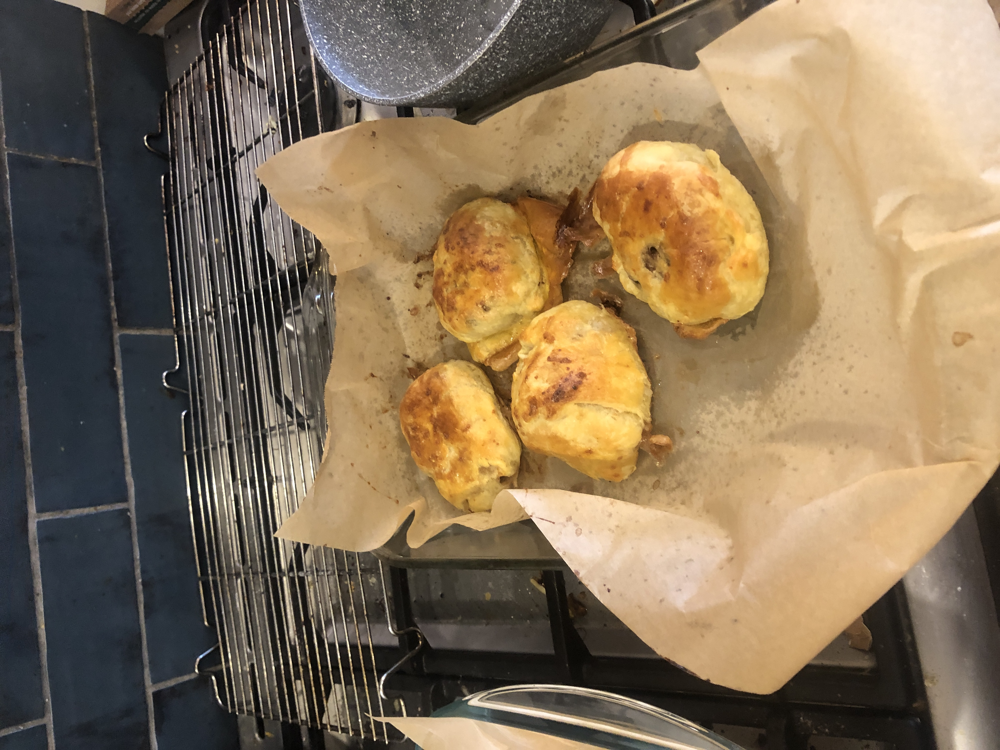
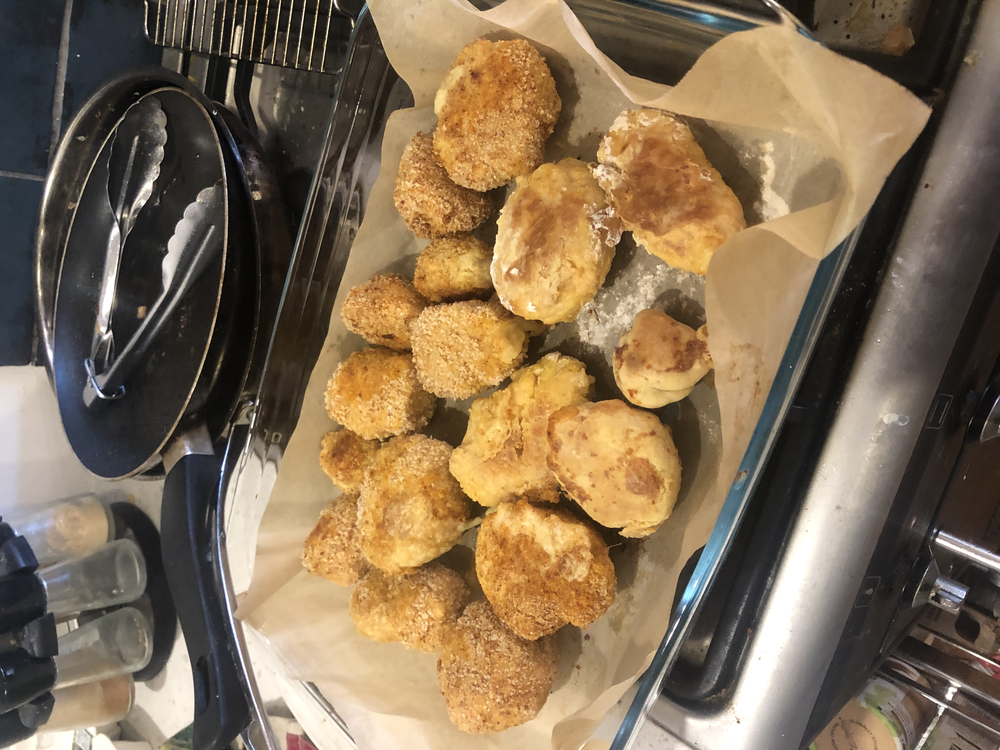
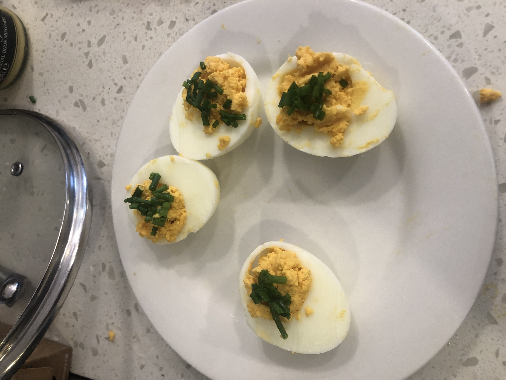
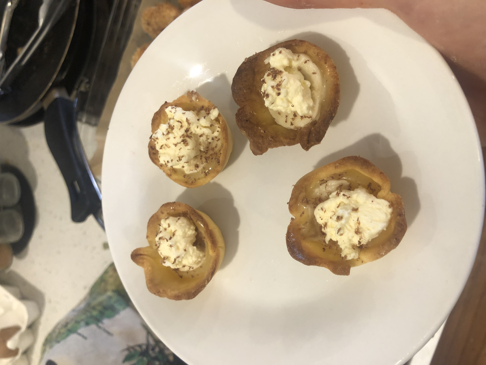

Busy busy times it is here, I am just over 24 hours away from finishing my Master's degree (see [GitHub](https://github.com/1jamesthompson1/AIML589)). This day was supposed to have food that was quicker too cook. In some ways it was the problem was that I just started soo late.

4 hours of cooking a messy kitchen like always that made 3 savoury items and 2 sweet. Just what was promised!

## The menu

**Savoury**:  
- [Beef Wellington](#beef-wellington)  
- [Cordon Bleu](#cordon-bleu)  
- [Devilled eggs](#devilled-eggs)  

**Sweet**:  
- [Banoffee Tartlets](#banoffee-tartlets)  
- [Lemon Posset](#lemon-posset)  

## The food

### Beef Wellington

AI has being suggesting this one too me for months when I was asking for recipes. I thought I should give in. It was good although I could of really made them much more mini.

[Beef Wellington Recipe](recipes/mini-beef-wellingtons.pdf)

### Cordon Bleu

The plan was for lamb meatballs yet there was no lamb. So chicken mince it was. The idea was from seeing some frozen ones and thinking "I could do better". I don't know if I was right, the shaping off them was tedious and messing and the outcome was a bit bland. A lot of the cheese fell out while cooking so need to iterate on this a bit. Some bites were good.

[Cordon Bleu Recipe](recipes/cordon-bleu.pdf)

### Devilled eggs

Nice and simple. I have a weird memory of being a kid and having devilled eggs and being so confused as I didn't understand why the eggs were evil. I remain confused.

[Devilled eggs Recipe](recipes/devilled-eggs.pdf)

### Banoffee Tartlets

These tartlets really turned out like Banoffee flavour I was thinking of. Only a little bit of banana goes a long way. My partner's favourite sweet.

[Banoffee Tartlets Recipe](recipes/mini-banoffee-tartlets.pdf)

### Lemon Posset

I didn't have small jars so had to use larger one and the serving sizes were way off. I started off confident yet we had to leave half to be eaten another time. Just too rich. This recipe should make 4 servings at least.

[Lemon Posset Recipe](recipes/lemon-posset.pdf)